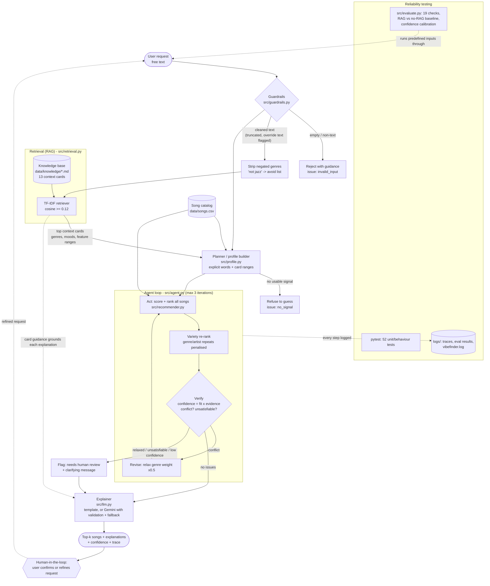

# VibeFinder 2.0: System Architecture

**How to read it.** A request passes the guardrails, then the retriever finds the context cards that best match it. The planner merges those cards (genres, moods, feature ranges) with anything the user typed explicitly into a scoring profile. The agent ranks the catalog, re-ranks for variety, and **verifies its own answer**: it computes a confidence score and checks for conflicts and impossible requests. On a conflict it revises the plan (relaxes the genre weight) and re-ranks. Anything it had to relax, or could not satisfy, is flagged for a human instead of being presented as certain. Testing sits outside the loop: pytest and the evaluation harness drive predefined inputs through the same entry point, and every agent step is written to `logs/`.
