# VibeFinder 3.0: System Architecture

```mermaid
flowchart TD
    U([Request in any language<br/>CLI, Streamlit UI or a follow-up]) --> CONV{Follow-up?<br/>src/session.py}
    CONV -- "more upbeat / not #3 / more like #2" --> REF[Edit last profile<br/>agent.refine]
    CONV -- "new request" --> G{Guardrails<br/>src/guardrails.py<br/>NFKC, invisible chars,<br/>override + distress detection}
    G -- "empty / non-text" --> RJ[Reject with guidance]
    G -- "flagged as override" --> RULES
    G -- "clean text" --> UND

    subgraph GEM["Gemini (src/gemini.py: retry, model fallback, disk cache, accounting)"]
        UND[Query understanding<br/>src/understanding.py<br/>JSON schema with catalog enums]
        QE[Query embedding<br/>gemini-embedding-2, 768-d]
        RR[Optional rerank<br/>src/rerank.py]
        EXP[Batched grounded explanations<br/>src/llm.py]
    end

    UND -- "validated Intent<br/>(unknown values dropped, ranges clamped)" --> PLAN
    UND -. "GeminiUnavailable" .-> RULES[Rule-based parser<br/>src/profile.py]
    RULES --> PLAN
    UND -. "cross-check vs rules<br/>logs/parser_disagreements.jsonl" .-> RULES

    subgraph RAG["Retrieval: src/retrieval.py, src/embeddings.py"]
        KB[(30 context cards<br/>data/knowledge)]
        IDX[(Prebuilt card index<br/>data/index, committed)]
        BM[BM25<br/>body-only discount]
        DN[Dense cosine]
        HY[Hybrid: RRF + MMR<br/>calibrated to one evidence scale]
        KB --> BM --> HY
        IDX --> DN --> HY
    end
    UND -- "English paraphrase" --> HY
    QE --> DN
    HY -. "dense unavailable: lexical,<br/>reason in the trace" .-> BM
    HY --> RR

    CAT[(580 real tracks<br/>data/songs.csv<br/>HF Spotify snapshot)] --> A
    RR -- "context cards" --> PLAN[Profile: explicit intent<br/>+ card genres, moods, ranges]
    PLAN -- "off-topic / no signal" --> NS[Refuse to guess]
    REF --> A

    subgraph AGENT["Agent loop: src/agent.py"]
        A[Act: score and rank]
        D[Variety re-rank]
        V{Verify: confidence = fit x evidence<br/>conflict, unsatisfiable,<br/>mixed context, exclusion only}
        RV[Revise: relax genre weight]
        A --> D --> V
        V -- "conflict" --> RV --> A
    end
    PLAN --> A

    V --> EXP
    EXP -. "a pick fails validation" .-> TPL[Template explanation]
    V -- "relaxed / unsatisfiable / low confidence / distress" --> HR[Needs human review<br/>+ message, support info]
    EXP --> OUT([Top-k tracks, explanations,<br/>confidence, trace])
    TPL --> OUT
    HR --> OUT
    OUT --> UI[Streamlit UI<br/>Deezer cover art + 30 s previews<br/>src/enrich.py]
    UI -. "follow-up" .-> U

    subgraph TESTING["Reliability"]
        T1[pytest: 388 tests, offline,<br/>fake Gemini SDK]
        T2[src/evaluate.py: behaviour cases,<br/>retrieval ablation on 44 labelled queries,<br/>26-attack injection suite]
        T3[tools/mutate.py: 63 planted bugs]
    end
```

**How to read it.** A new request passes the guardrails. When Gemini is available it reads the request into a schema-constrained intent; the validator throws away anything outside the catalog's own vocabulary, and if Gemini is down, rate-limited or the input was flagged, the original rule-based parser takes over. Hybrid retrieval finds the listening contexts that match (BM25 and dense embeddings, fused with Reciprocal Rank Fusion and diversified with MMR), on one calibrated evidence scale, so the agent's thresholds mean the same thing in every mode. The agent ranks the 580-track catalog, re-ranks for variety and verifies its own answer; anything it had to relax or could not satisfy is flagged for a human. Gemini then explains every pick in one call, each explanation validated against its own facts. Follow-ups such as "more upbeat" edit the previous profile rather than starting over. Every Gemini call is cached on disk, so a demo works on a tight free-tier quota and the evaluation is reproducible.
